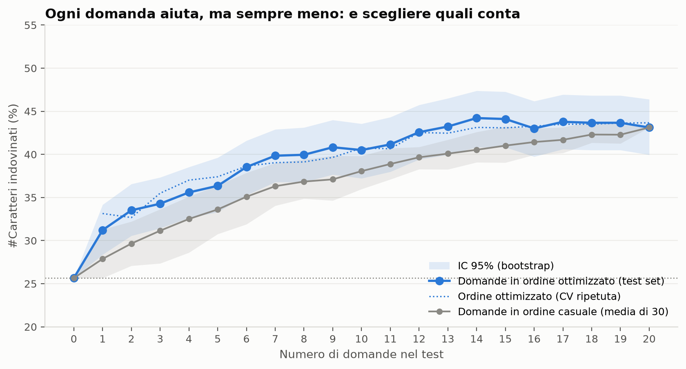
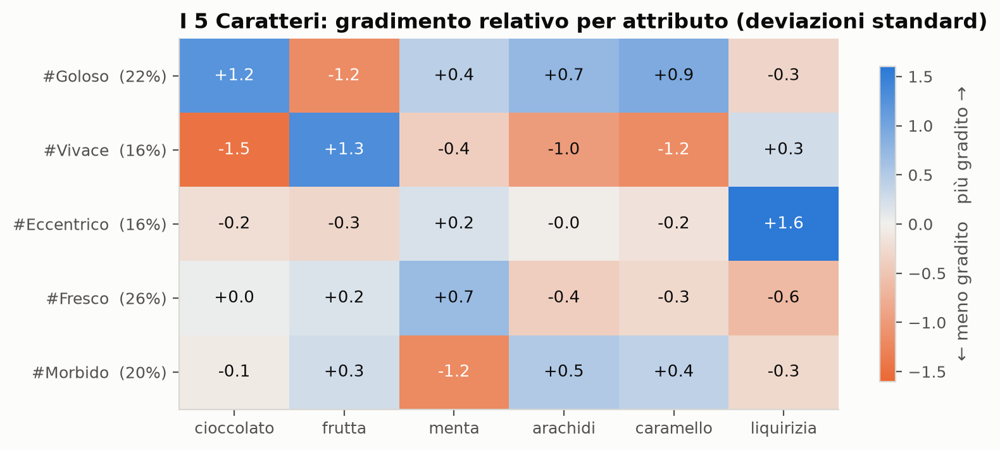
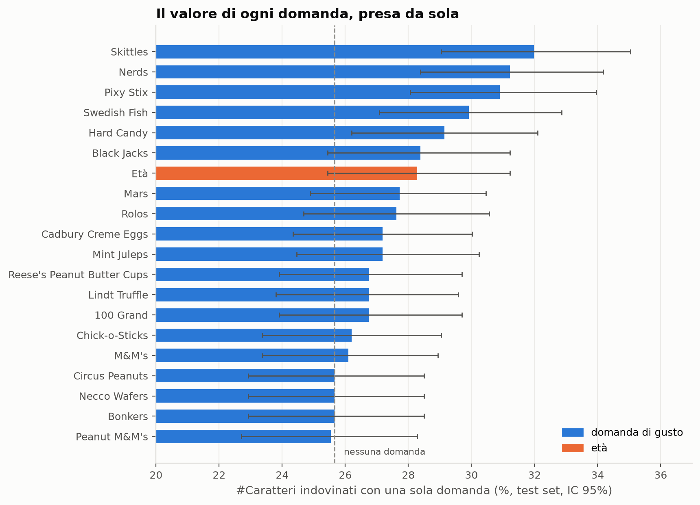
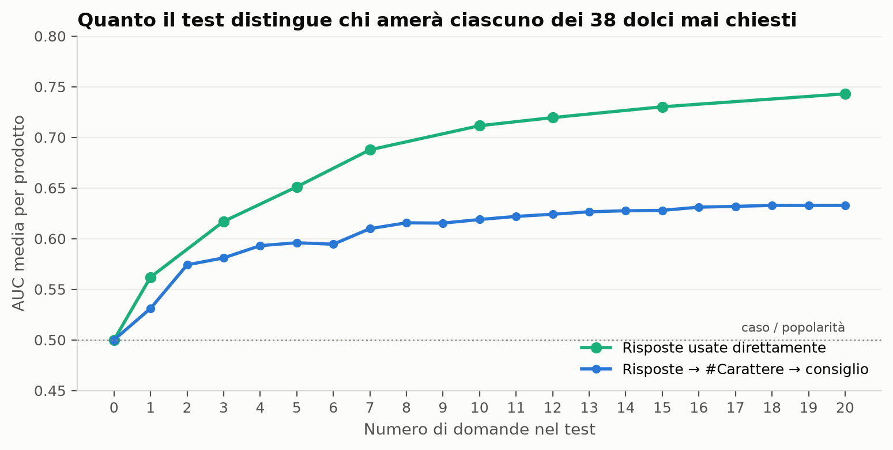
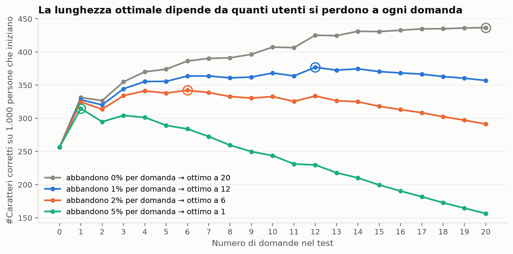
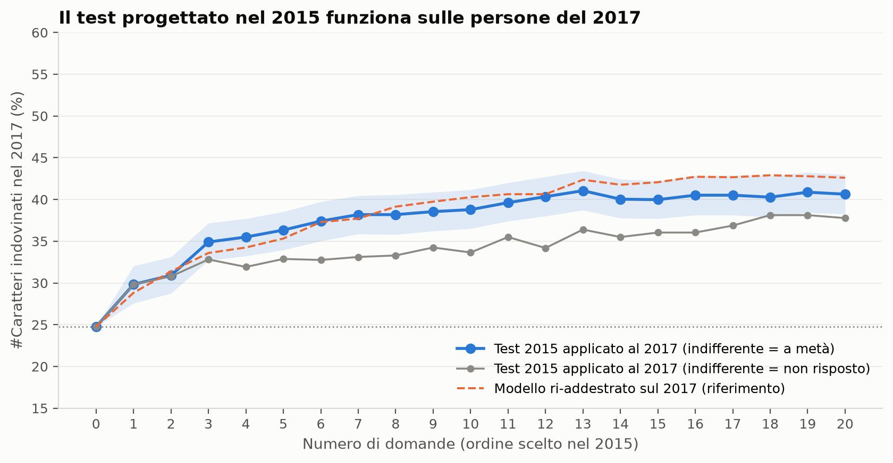

# Quante domande servono davvero a un Taste Test?


[Contesto](#contesto-del-progetto) · [Metriche chiave](#metriche-chiave) · [Sintesi](#sintesi) · [Approfondimenti](#approfondimenti) · [Raccomandazioni](#raccomandazioni) · [Repository](#repository-e-come-eseguirlo)

> Analisi in Python di **6.255 consumatori** che valutano **57 dolci** in due sondaggi, a due anni di distanza. Un test di **12 domande** raggiunge il **90% dell'accuratezza ottenibile**. **7 domande ben scelte valgono quanto ~13 scelte a caso**. Il test progettato sui dati 2015 funziona **senza modifiche su persone nuove nel 2017**: riconosce il 40% dei profili di gusto, contro il 43% del 2015.

<a id="contesto-del-progetto"></a>
## Contesto del progetto

Un Taste Test profila i consumatori con poche domande rapide e consiglia i prodotti adatti al loro palato. Ogni domanda ha un costo: **ogni domanda in più fa perdere utenti, ogni domanda in meno rende il profilo meno preciso**. La lunghezza del test e la scelta delle domande decidono quante persone arrivano alla fine e quanto sono buoni i consigli.

Il progetto risponde a cinque domande di business con il sondaggio *Candy Hierarchy*, in cui migliaia di persone valutano i dolci di Halloween come "gioia" o "delusione":

1. È possibile raggruppare i consumatori in pochi **profili di gusto** stabili e interpretabili?
2. Quanto migliora il riconoscimento del profilo **ogni domanda in più**, e quando il guadagno si esaurisce?
3. **Quali** domande conviene fare: domande sul gusto o domande demografiche?
4. Un test breve sa anche **consigliare prodotti** che alla persona non sono mai stati chiesti?
5. Un test progettato su un sondaggio funziona ancora su **persone nuove, due anni dopo**?

Il disegno è **non circolare**: 38 dolci definiscono il profilo di gusto di ogni persona; gli altri 19, più l'età, sono il serbatoio di domande del test. Il test deve quindi indovinare i gusti su prodotti che **non ha mai chiesto**.

<a id="metriche-chiave"></a>
## Metriche chiave

| **12 domande** | **7 ≈ 13** | **0,74 vs 0,63** | **5 su 5** |
|:---:|:---:|:---:|:---:|
| raggiungono il 90% dell'accuratezza ottenibile | 7 domande ben scelte valgono quanto ~13 casuali | AUC dei consigli diretti contro quelli dedotti dal profilo | profili di gusto che riemergono da zero nel 2017 (r = 0,93–0,99) |

<a id="sintesi"></a>
## Sintesi

[](figures/03_curva_domande_accuratezza.png)

| Domande nel test | Profili riconosciuti, 2015 (test set) | Quota del guadagno ottenibile (CV) | Stesso test sui rispondenti 2017 |
|---|---|---|---|
| *0 (a tutti il profilo più comune)* | *25,7%* | *0%* | *24,8%* |
| 1 | 31,2% | 42% | 29,8% |
| 7 | 39,8% | 74% | 38,2% |
| **12** | **42,6%** | **94%** | **40,3%** |
| 20 (tutte) | 43,1% | 100% | 40,6% |

*I profili sono 5, quindi tirando a indovinare si otterrebbe il 20%. La "quota del guadagno ottenibile" è il miglioramento rispetto a 0 domande, in percentuale del miglioramento massimo, stimato con una cross-validation ripetuta sul training set 2015.*

**Cosa significa**

- **Ogni domanda aiuta, ma sempre meno.** Il gomito cade tra **8 e 12 domande**. Dalla 8ª domanda in poi il test non è più significativamente peggiore del test completo di 20 domande (test di McNemar); a 12 domande raggiunge il 90% del guadagno ottenibile.
- **Quali domande conta quanto quante.** Con le domande in ordine ottimizzato ne bastano 7 per arrivare al 40%; in ordine casuale ne servono circa 13. Le domande migliori **dividono il pubblico**; quelle sui dolci amati da quasi tutti servono a poco.
- **Le domande sul gusto battono quelle demografiche.** L'età vale quanto una domanda di gusto mediocre ed entra nel test solo come 14ª domanda.
- **Il risultato regge su persone nuove.** Il test del 2015 applicato senza modifiche a 1.676 rispondenti del 2017 resta entro 1–2 punti da un modello ri-addestrato sul 2017, e il suo gomito cade a 11 domande.

<a id="approfondimenti"></a>
## Approfondimenti

### 1. Cinque profili di gusto sensoriali e stabili
[Notebook 02](notebooks/02_profili_di_gusto.ipynb)

[](figures/02_profili_heatmap.png)

| Profilo | Quota | Gusto |
|---|---|---|
| **Goloso** | 22% | Le barrette classiche: cioccolato con arachidi e caramello; rifiuta i fruttati |
| **Vivace** | 16% | Dolci fruttati e aciduli; rifiuta il cioccolato più ricco |
| **Eccentrico** | 16% | Ama la liquirizia, il gusto più divisivo del catalogo |
| **Fresco** | 26% | Ama la menta (York, Junior Mints); poco la liquirizia |
| **Morbido** | 20% | Rifiuta la menta; preferisce sapori dolci e rotondi |

Ogni profilo si basa sul **gradimento relativo** per sei attributi sensoriali: cioccolato, frutta, menta, arachidi, caramello e liquirizia. "Relativo" significa misurato rispetto alla media della persona stessa: così i profili descrivono che cosa piace di più, non quanto una persona è generosa nei giudizi. I profili costruiti dolce per dolce risultavano instabili; riassumere per attributo ha risolto il problema.

Con 5 e 6 profili la stabilità al ricampionamento bootstrap è praticamente la stessa (ARI medio 0,868 contro 0,878 su tre divisioni del catalogo). Ho scelto 5 profili perché sono più semplici da comunicare e ognuno contiene più persone. I profili superano anche tre controlli:
- mostrano lo stesso schema su **19 dolci mai usati per costruirli** (r = 0,93);
- restano gli stessi cambiando la divisione del catalogo (correlazione tra i centri 0,97);
- sono legati all'età solo in modo debole (V di Cramér = 0,12).

### 2. Ogni domanda aiuta, ma sempre meno
[Notebook 03](notebooks/03_valore_delle_domande.ipynb)

Le domande vengono aggiunte una alla volta, scegliendo ogni volta quella che migliora di più il test. La scelta si fa solo sul training set, e il risultato si misura su circa 920 persone tenute da parte. L'accuratezza passa dal 26% al 31% con una domanda, al 40% con 7 e al 43–44% con 12–14; dopo, le ultime 6 domande non aggiungono nulla. Un gradient boosting con tutte le domande non fa meglio (42,2% contro 43,1%): il plateau dipende dall'informazione contenuta nelle domande, non dal modello.

### 3. Le domande migliori dividono il pubblico
[Notebook 03](notebooks/03_valore_delle_domande.ipynb)

[](figures/03_valore_singole_domande.png)

Prese da sole, le domande più informative sono quelle sui **dolci fruttati** (Skittles 32%, Nerds 31%). La frutta è l'attributo che divide di più le persone, perché è l'opposto del cioccolato. Le domande sui dolci amati da quasi tutti sono quasi inutili (Reese's 27%, M&M's 26%), perché quasi tutti rispondono "gioia". L'età da sola arriva al 28%.

### 4. Un profilo si riconosce solo se il test lo interroga
[Notebook 03](notebooks/03_valore_delle_domande.ipynb)

| Profilo | Riconosciuto (12 domande) | Attributo che lo definisce | Domande del serbatoio con quell'attributo |
|---|---|---|---|
| Goloso | 64% | cioccolato | 8 |
| Vivace | 43% | frutta | 6 |
| *Eccentrico* | *26%* | *liquirizia* | *1* |
| Fresco | 52% | menta | 1 |
| *Morbido* | *20%* | *menta* | *1* |

I profili definiti da liquirizia e menta vengono riconosciuti poco, perché il serbatoio ha un solo dolce per ciascuno di questi attributi. Fresco è l'eccezione: essendo il profilo più numeroso, il modello lo assegna "per default" quando le risposte non indicano altro.

### 5. Il profilo comunica, un modello diretto consiglia
[Notebook 03](notebooks/03_valore_delle_domande.ipynb)

[](figures/03_consigli_auc.png)

Per ciascuno dei 38 dolci mai chiesti, il test deve distinguere chi lo amerà da chi no.
- Consigliare per **popolarità** dà un'AUC di 0,5, perché dice a tutti la stessa cosa.
- I consigli dedotti dal **profilo** (5 categorie) arrivano a **0,63**.
- Usando le risposte **direttamente**, con un modello per ogni prodotto, si arriva a **0,74**, e il risultato continua a migliorare con più domande.

Il profilo comprime ogni persona in 5 categorie e perde le sfumature individuali.

### 6. La lunghezza ottimale dipende dall'abbandono per domanda
[Notebook 03](notebooks/03_valore_delle_domande.ipynb)

[](figures/03_lunghezza_ottimale.png)

| Abbandono per domanda | Lunghezza ottimale |
|---|---|
| 0% | 20 domande (guadagno minimo dopo 12–14) |
| **1%** | **12 domande** |
| **2%** | **6 domande** |
| 5% | 1 domanda |

Il valore del test è modellato come *profili corretti consegnati = persone che completano × accuratezza*. Per ogni domanda esiste un **abbandono di pareggio**: se la domanda fa perdere più utenti di quella quota, conviene toglierla. È oltre il 20% per la 1ª domanda, l'8% per la 3ª, il 3–4% intorno alla 10ª–12ª e meno dell'1% dalla 15ª in poi.

Un test adattivo, costruito come albero decisionale, è leggermente più efficiente fino a circa 6 domande, ma si ferma intorno al 40%.

### 7. Il test funziona su persone nuove, due anni dopo
[Notebook 04](notebooks/04_replica_2017.ipynb)

[](figures/04_curva_trasferimento.png)

Sul sondaggio 2017 non viene ricalcolato nulla: divisione del catalogo, centri dei profili, ordine delle domande e modelli vengono tutti dal 2015.
- Una segmentazione del 2017 fatta **da zero** ritrova gli stessi 5 profili, con correlazioni tra i centri di 0,93–0,99 e quote quasi identiche.
- L'88% dei rispondenti 2017 riceve lo stesso profilo sia con i centri 2015 sia con la nuova segmentazione.
- Il test 2015 arriva al 40,3% con 12 domande, contro il 40,6% di un modello ri-addestrato sul 2017.

Il sondaggio 2017 aggiunge l'opzione "indifferente". Codificarla a metà tra gioia e delusione, invece che come risposta mancante, vale **fino a 5 punti** di accuratezza: un cambio di formato della risposta va ricalibrato.

**Dettagli tecnici**

```
3 file CSV ──► catalogo e pulizia ──► profili di gusto ──► valore delle domande ──► replica
(2015, 2017,    (57 dolci,             (k-means su 6        (forward selection,       (test 2015 applicato
 FiveThirtyEight) 4.579 + 1.676 persone) punteggi sensoriali) IC, McNemar)             senza modifiche al 2017)
                notebook 01            notebook 02          notebook 03               notebook 04
```

- **Prima di tutto la qualità dei dati:**
  - le 95 voci del sondaggio diventano 57 dolci reali presenti in entrambi gli anni; regole esplicite escludono i non-prodotti (contanti, Vicodin, matite), i dolci inventati o fuori commercio e i giudizi generici;
  - si eliminano righe vuote, 77 invii duplicati, valutazioni incomplete (<80%) e straight-liner;
  - l'età è estratta dal testo libero, e i valori fuori da 3–100 diventano "non validi".
- **Nomi allineati tra gli anni:** i nomi dei dolci sono normalizzati per gestire apostrofi tipografici e un errore di codifica nel file 2017.
- **Controllo della codifica sensoriale:** la codifica manuale dei sei attributi è confrontata con FiveThirtyEight. Coincide al 100% su cioccolato, caramello e arachidi; gli unici 2 disaccordi, sulla frutta, sono questioni di definizione.
- **Profili:** gradimento relativo centrato su ogni persona e standardizzato; numero di profili scelto per stabilità al bootstrap (ARI, 50 ricampionamenti) su tre divisioni del catalogo.
- **Valore delle domande:**
  - split train/test 80/20; forward selection con log loss in cross-validation, solo sul training set;
  - intervalli di confidenza bootstrap al 95% (2.000 ricampionamenti) e test di McNemar appaiati;
  - cross-validation ripetuta 5×5 e confronto con 30 ordini casuali delle domande;
  - un albero decisionale come test adattivo e un gradient boosting come controllo del modello.
- **Robustezza:** l'intera pipeline è stata rieseguita su altre due divisioni del catalogo, con la stessa forma della curva (43–46% a 12 domande).
- **SQL (DuckDB):** join, aggregazioni e margini di confidenza sulle valutazioni in formato lungo (notebook 01).

<a id="raccomandazioni"></a>
## Raccomandazioni

1. **Misurare prima di tutto l'abbandono reale per domanda.** È il numero che fissa la lunghezza ottimale: 12 domande con l'1% di abbandono, 6 con il 2%. Il modello del notebook 03 lo trasforma direttamente in una lunghezza consigliata.
2. **Progettare il serbatoio di domande per copertura sensoriale.** Ogni attributo che definisce un profilo deve avere almeno 2–3 domande; altrimenti profili come Eccentrico e Morbido restano invisibili.
3. **Fare domande che dividono il pubblico** e valutare ogni nuova domanda con il suo guadagno marginale, con intervalli di confidenza, prima di inserirla nel test.
4. **Tenere due strumenti per due compiti.** Il profilo di gusto per comunicare (un nome, una descrizione, un segmento per il marketing); un modello diretto per consigliare prodotti.
5. **Ricalibrare ogni volta che cambia il formato della risposta.** Aggiungere un'opzione "neutra" ha cambiato l'accuratezza fino a 5 punti, a seconda di come veniva codificata.

<a id="repository-e-come-eseguirlo"></a>
## Repository e come eseguirlo

```
taste-test-length/
├── data/
│   ├── raw/                              # Candy Hierarchy 2015 e 2017, attributi FiveThirtyEight
│   └── processed/                        # file intermedi, rigenerati dai notebook
├── notebooks/
│   ├── 01_pulizia_dati.ipynb             # catalogo, esclusioni, qualità dei rispondenti, SQL
│   ├── 02_profili_di_gusto.ipynb         # profili di gusto sensoriali, stabilità, validazione
│   ├── 03_valore_delle_domande.ipynb     # valore delle domande, ordine ottimale, test adattivo, lunghezza ottimale
│   ├── 04_replica_2017.ipynb             # replica sui rispondenti 2017
│   ├── catalogo.py                       # catalogo dei dolci e regole di esclusione
│   └── stile_grafici.py                  # stile grafico condiviso
├── figures/                              # grafici esportati dai notebook
├── requirements.txt
└── README.md
```

```bash
git clone https://github.com/AlessandroCucchi/taste-test-length.git
cd taste-test-length
python -m venv .venv
source .venv/bin/activate          # Windows: .venv\Scripts\activate
pip install -r requirements.txt
cd notebooks
jupyter notebook                   # eseguire 01 → 02 → 03 → 04 in ordine
```

*I notebook sono salvati con i loro output, quindi si possono leggere anche senza eseguirli.*

**Dati:**
- [Candy Hierarchy](https://www.scq.ubc.ca/?p=4471) 2015 e 2017, di David Ng e Ben Cohen (University of British Columbia, pubblicato su BoingBoing): 5.658 e 2.460 righe di sondaggio. Il file grezzo 2015 viene da [jennybc/candy](https://github.com/jennybc/candy).
- [FiveThirtyEight Candy Power Ranking](https://github.com/fivethirtyeight/data/tree/master/candy-power-ranking): attributi di 85 dolci.

## Autore

**Alessandro Cucchi**

[](https://www.linkedin.com/in/alessandrocucchi-)
[](https://github.com/AlessandroCucchi)
